# JS2 Test – Complete Solutions

**6 Questions | JavaScript Problem-Solving Guide**

A comprehensive JavaScript problem-solving guide covering **Nested Loops, Searching, Time Complexity, Map, Set, Strings, Recursion, Memoization, Sorting, Backtracking, Closures, Callbacks, and Higher-Order Functions**.

---

## Table of Contents

- [Q1: Reverse Number Triangle](#q1-reverse-number-triangle)
- [Q2: Searching and Complexity](#q2-searching-and-complexity)
  - [Binary Search](#q2a-binary-search)
  - [Time Complexity](#q2b-time-complexity-analysis)
- [Q3: Map, Set and Strings](#q3-map-set-and-strings)
  - [First Repeated Word](#q3a-first-repeated-word-using-set)
  - [Character Frequency](#q3b-character-frequency-using-map)
- [Q4: Recursion and Memoization](#q4-recursion-and-memoization)
  - [Sum of Digits](#q4a-sum-of-digits-using-recursion)
  - [Climbing Stairs](#q4b-climbing-stairs-using-memoization)
- [Q5: Sorting and Backtracking](#q5-sorting-and-backtracking)
  - [Insertion Sort](#q5a-insertion-sort)
  - [String Generation](#q5b-generate-strings-using-backtracking)
- [Q6: Callbacks, Closures and Higher-Order Functions](#q6-callbacks-closures-and-higher-order-functions)
  - [Discount Calculator](#q6a-create-discount-using-closure)
  - [Student Filtering](#q6b-filter-and-map-students)
- [Final Complexity Cheat Sheet](#final-complexity-cheat-sheet)
- [Important JavaScript Concepts](#important-javascript-concepts--quick-revision)

---

# Q1: Reverse Number Triangle

**Marks:** 10 | **Time:** 10 Minutes

**Topics:** Nested Loops, Pattern Programming

## 1. Problem Statement

Print a triangle pattern where each row contains numbers starting from the current row number up to `n`.

### Example

**Input:**

```javascript
n = 5;
```

**Output:**

```text
5
4 5
3 4 5
2 3 4 5
1 2 3 4 5
```

## 2. Approach

- Use an outer loop to control the rows.
- Start the outer loop from `n` and decrement it until `1`.
- Use an inner loop to print numbers from the current row number to `n`.
- Print each row on a new line.

## 3. JavaScript Solution

```javascript
function reverseTriangle(n) {
    for (let i = n; i >= 1; i--) {
        let row = "";

        for (let j = i; j <= n; j++) {
            row += j + " ";
        }

        console.log(row.trim());
    }
}

// Example
reverseTriangle(5);
```

## 4. Output

```text
5
4 5
3 4 5
2 3 4 5
1 2 3 4 5
```

## 5. Flowchart

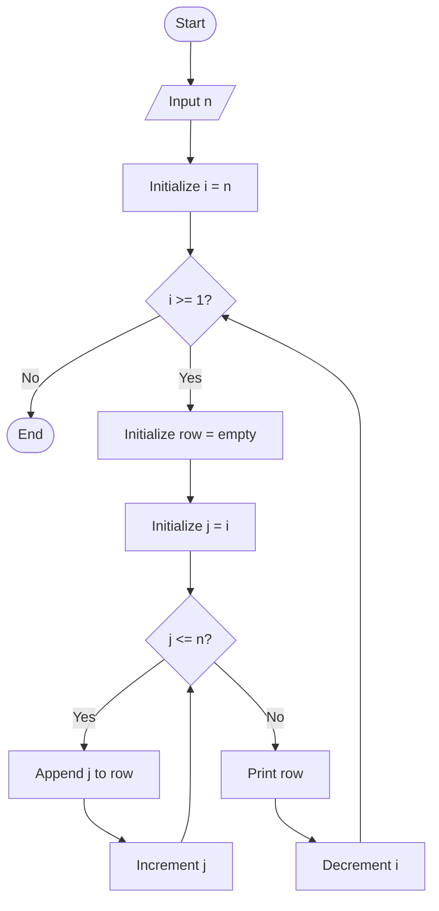

## 6. Complexity Analysis

| Complexity | Value | Explanation |
|---|---|---|
| Time | O(n²) | Nested loops generate approximately n²/2 numbers. |
| Space | O(n) | Stores the current row. |

---

# Q2: Searching and Complexity

**Marks:** 15 | **Time:** 15 Minutes

**Topics:** Binary Search, Time Complexity, Big-O

## Q2(a): Binary Search

**Marks:** 10

### 1. Problem Statement

Implement a binary search function that returns the index of a target element in a sorted array.

If the target is absent, return `-1`.

### 2. Approach

Binary Search repeatedly divides the search space into two halves.

1. Initialize `left` and `right`.
2. Calculate the middle index.
3. Compare the middle element with the target.
4. If equal, return the index.
5. If the middle element is smaller, search the right half.
6. Otherwise, search the left half.
7. Return `-1` if the search space becomes empty.

### 3. JavaScript Solution

```javascript
function binarySearch(arr, target) {
    let left = 0;
    let right = arr.length - 1;

    while (left <= right) {
        const mid = Math.floor((left + right) / 2);

        if (arr[mid] === target) {
            return mid;
        }

        if (arr[mid] < target) {
            left = mid + 1;
        } else {
            right = mid - 1;
        }
    }

    return -1;
}

// Examples
console.log(binarySearch([1, 3, 5, 7, 9, 11], 7));
// Output: 3

console.log(binarySearch([1, 3, 5, 7, 9], 4));
// Output: -1
```

### 4. Dry Run

**Input:**

```javascript
arr = [1, 3, 5, 7, 9, 11];
target = 7;
```

| Iteration | Left | Right | Mid | arr[mid] | Action |
|---|---:|---:|---:|---:|---|
| 1 | 0 | 5 | 2 | 5 | Search right |
| 2 | 3 | 5 | 4 | 9 | Search left |
| 3 | 3 | 3 | 3 | 7 | Found |

**Result:** `3`

### 5. Flowchart

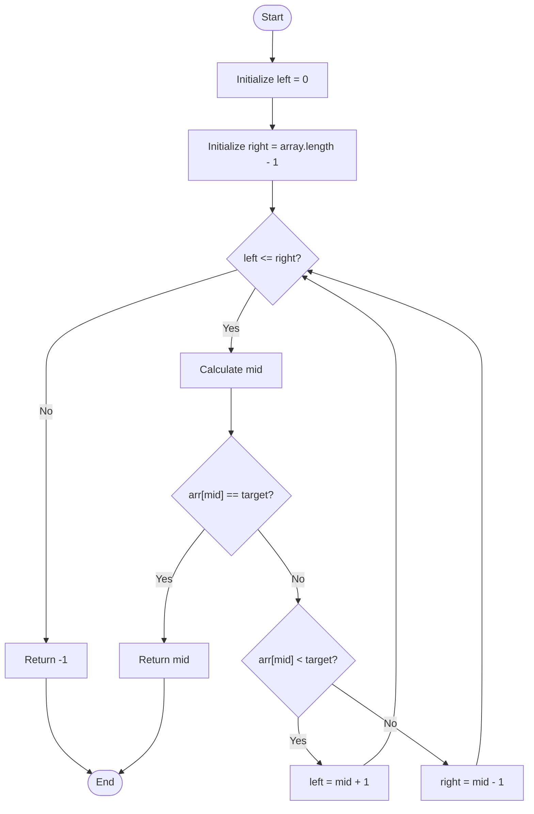

### 6. Complexity Analysis

| Case | Complexity |
|---|---|
| Best Case | O(1) |
| Average Case | O(log n) |
| Worst Case | O(log n) |
| Space | O(1) |

---

## Q2(b): Time Complexity Analysis

**Marks:** 5

### 1. Given Code

```javascript
for (let i = 1; i < n; i *= 2) {
    console.log(i);
}
```

### 2. Explanation

The loop starts with `i = 1`.

In every iteration, the value of `i` is multiplied by 2.

Sequence:

```text
1 → 2 → 4 → 8 → 16 → 32 → 64 → ...
```

The loop terminates when `i >= n`.

Mathematically:

```text
2^k >= n

k >= log₂(n)
```

### 3. Final Answer

**Time Complexity: O(log n)**

**Space Complexity: O(1)**

Since the loop variable doubles during every iteration, the number of iterations grows logarithmically with the input size.

### 4. Flowchart

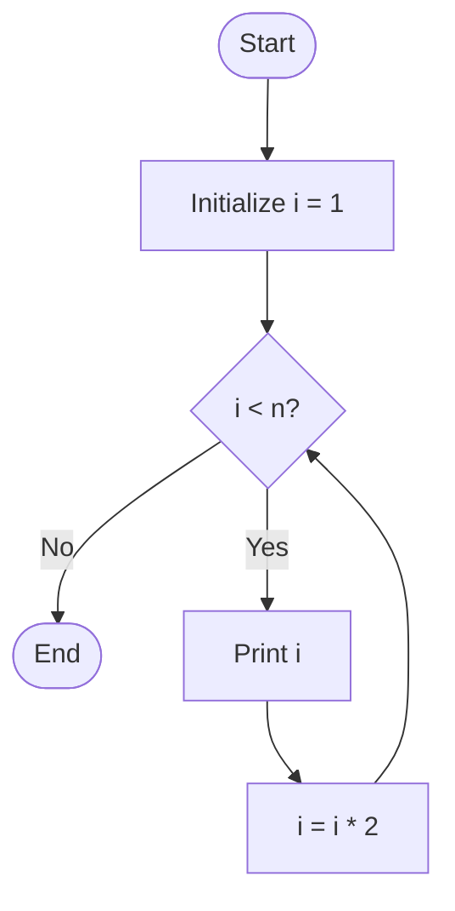

---

# Q3: Map, Set and Strings

**Marks:** 15 | **Time:** 15 Minutes

**Topics:** Set, Map, String Manipulation

## Q3(a): First Repeated Word Using Set

**Marks:** 8

### 1. Problem Statement

Implement a function `firstRepeatedWord(words)` that returns the first word encountered for a second time.

If no word is repeated, return `null`.

### 2. Example

**Input:**

```javascript
["red", "blue", "green", "blue", "red"];
```

**Output:**

```text
blue
```

### 3. Approach

Use a JavaScript `Set`.

- Create an empty Set.
- Traverse the array.
- Check whether the current word already exists.
- If it exists, return that word.
- Otherwise, add it to the Set.
- Return `null` if no repeated word is found.

### 4. JavaScript Solution

```javascript
function firstRepeatedWord(words) {
    const seen = new Set();

    for (const word of words) {
        if (seen.has(word)) {
            return word;
        }

        seen.add(word);
    }

    return null;
}

// Example
const words = ["red", "blue", "green", "blue", "red"];

console.log(firstRepeatedWord(words));
// Output: "blue"
```

### 5. Dry Run

| Word | Already Exists? | Set |
|---|---|---|
| red | No | {red} |
| blue | No | {red, blue} |
| green | No | {red, blue, green} |
| blue | Yes | Return blue |

### 6. Flowchart

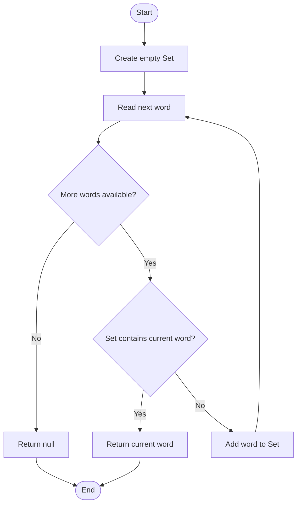

### 7. Complexity Analysis

| Complexity | Value |
|---|---|
| Time | O(n) |
| Space | O(n) |

**Reason:** Every word is visited at most once, and the Set can store up to `n` unique words.

---

## Q3(b): Character Frequency Using Map

**Marks:** 7

### 1. Problem Statement

Implement a function `charFrequency(text)` using a Map to count the frequency of every character.

### 2. Example

**Input:**

```javascript
"aabbc"
```

**Output:**

```text
a:2
b:2
c:1
```

### 3. Approach

Use a Map with:

- Key: Character.
- Value: Frequency.

For each character:

1. Check whether it exists in the Map.
2. If it exists, increment its frequency.
3. Otherwise, initialize its frequency to 1.

### 4. JavaScript Solution

```javascript
function charFrequency(text) {
    const frequency = new Map();

    for (const char of text) {
        if (frequency.has(char)) {
            frequency.set(
                char,
                frequency.get(char) + 1
            );
        } else {
            frequency.set(char, 1);
        }
    }

    return frequency;
}

// Example
const result = charFrequency("aabbc");

for (const [char, count] of result) {
    console.log(`${char}:${count}`);
}
```

### 5. Output

```text
a:2
b:2
c:1
```

### 6. Dry Run

| Character | Operation | Frequency |
|---|---|---|
| a | Insert | a → 1 |
| a | Increment | a → 2 |
| b | Insert | b → 1 |
| b | Increment | b → 2 |
| c | Insert | c → 1 |

Final Map:

```javascript
Map {
    "a" => 2,
    "b" => 2,
    "c" => 1
}
```

### 7. Flowchart

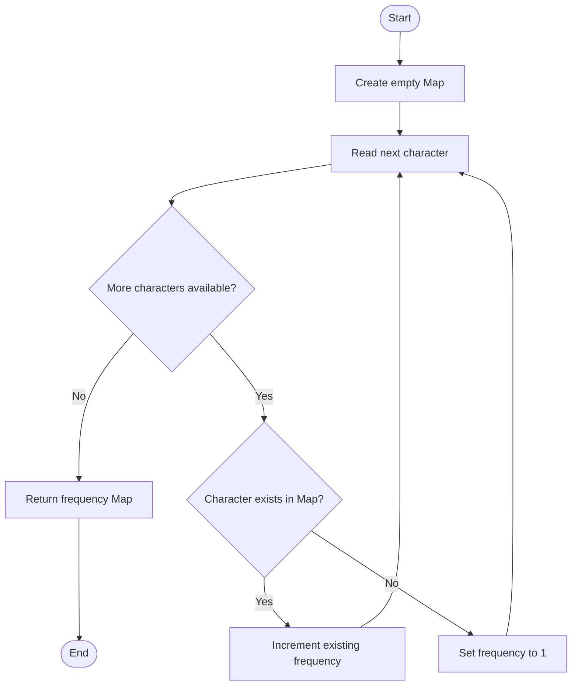

### 8. Complexity Analysis

| Complexity | Value |
|---|---|
| Time | O(n) |
| Space | O(k) |

Where:

- `n` = Length of the input string.
- `k` = Number of distinct characters.

---

# Q4: Recursion and Memoization

**Marks:** 20 | **Time:** 20 Minutes

**Topics:** Recursion, Base Case, Memoization, Dynamic Programming

## Q4(a): Sum of Digits Using Recursion

**Marks:** 10

### 1. Problem Statement

Write a recursive function `sumDigits(n)` that calculates the sum of digits of a non-negative integer.

### 2. Example

**Input:**

```javascript
472
```

**Output:**

```text
13
```

### 3. Approach

Use two mathematical operations:

- `n % 10`: Extracts the last digit.
- `Math.floor(n / 10)`: Removes the last digit.

The recursive function continues until `n` becomes zero.

### 4. JavaScript Solution

```javascript
function sumDigits(n) {
    // Base Case
    if (n === 0) {
        return 0;
    }

    // Recursive Case
    return (n % 10) +
        sumDigits(Math.floor(n / 10));
}

// Example
console.log(sumDigits(472));
// Output: 13
```

### 5. Recursion Dry Run

```text
sumDigits(472)
    = 2 + sumDigits(47)

sumDigits(47)
    = 7 + sumDigits(4)

sumDigits(4)
    = 4 + sumDigits(0)

sumDigits(0)
    = 0
```

Returning:

```text
sumDigits(0)   = 0
sumDigits(4)   = 4
sumDigits(47)  = 11
sumDigits(472) = 13
```

### 6. Recursion Diagram

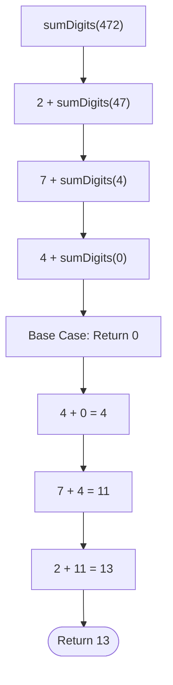

### 7. Base Case Explanation

```javascript
if (n === 0) {
    return 0;
}
```

The base case stops the recursive calls when the number becomes zero.

Without a base case, recursion would continue indefinitely.

### 8. Complexity Analysis

| Complexity | Value |
|---|---|
| Time | O(log n) |
| Space | O(log n) |

**Reason:** One digit is removed during every recursive call. The recursion depth equals the number of digits.

---

## Q4(b): Climbing Stairs Using Memoization

**Marks:** 10

### 1. Problem Statement

You can climb a staircase using either:

- 1 step at a time.
- 2 steps at a time.

Write a memoized recursive function `climbWays(n)` that calculates the total number of ways to reach step `n`.

### 2. Example

**Input:**

```javascript
4
```

**Output:**

```text
5
```

### 3. Possible Combinations

```text
1 + 1 + 1 + 1
1 + 1 + 2
1 + 2 + 1
2 + 1 + 1
2 + 2
```

Total ways = 5.

### 4. Mathematical Approach

The recurrence relation:

```text
f(n) = f(n - 1) + f(n - 2)
```

Base cases:

```text
f(0) = 1
f(1) = 1
```

To reach step `n`, we can:

- Come from step `n - 1` using one step.
- Come from step `n - 2` using two steps.

### 5. JavaScript Solution

```javascript
function climbWays(n, memo = {}) {
    // Base Cases
    if (n === 0 || n === 1) {
        return 1;
    }

    // Check Memo
    if (memo[n] !== undefined) {
        return memo[n];
    }

    // Recursive Calculation
    memo[n] =
        climbWays(n - 1, memo) +
        climbWays(n - 2, memo);

    return memo[n];
}

// Example
console.log(climbWays(4));
// Output: 5
```

### 6. Memoization Explanation

Memoization stores previously calculated results to avoid repeated recursive calculations.

Example:

```javascript
memo = {
    2: 2,
    3: 3,
    4: 5
};
```

When `climbWays(2)` is needed again, the function retrieves the stored result rather than recalculating it.

### 7. Recursion Diagram

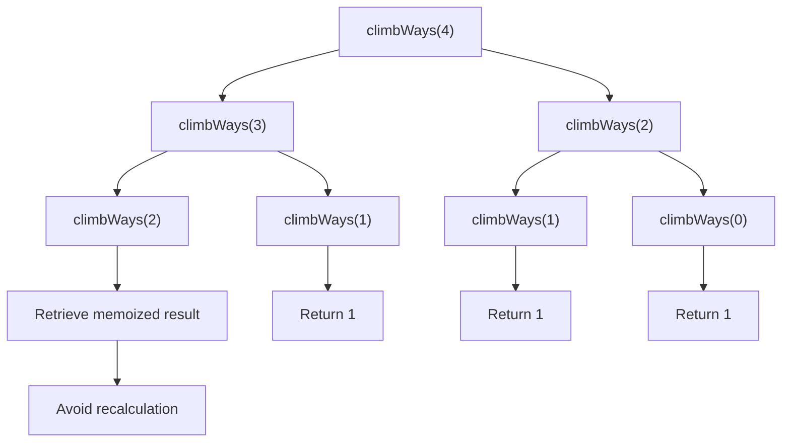

### 8. Complexity Analysis

| Complexity | Without Memoization | With Memoization |
|---|---|---|
| Time | O(2ⁿ) | O(n) |
| Space | O(n) | O(n) |

**Key Concept:** Memoization is a top-down Dynamic Programming technique that stores previously calculated results.

---

# Q5: Sorting and Backtracking

**Marks:** 20 | **Time:** 20 Minutes

**Topics:** Insertion Sort, Sorting, Recursion, Backtracking

## Q5(a): Insertion Sort

**Marks:** 10

### 1. Problem Statement

Implement Insertion Sort to arrange the following array in ascending order without using `sort()`.

```javascript
[7, 4, 9, 2, 6]
```

Also show the array after the first two outer-loop passes.

### 2. Approach

Insertion Sort works by maintaining a sorted portion of the array.

1. Start from index 1.
2. Store the current element in `key`.
3. Compare the key with previous elements.
4. Shift larger elements one position to the right.
5. Insert the key in the correct position.
6. Repeat until the array is sorted.

### 3. JavaScript Solution

```javascript
function insertionSort(arr) {
    for (let i = 1; i < arr.length; i++) {
        let key = arr[i];
        let j = i - 1;

        while (j >= 0 && arr[j] > key) {
            arr[j + 1] = arr[j];
            j--;
        }

        arr[j + 1] = key;
    }

    return arr;
}

// Example
const numbers = [7, 4, 9, 2, 6];

console.log(insertionSort(numbers));
// Output: [2, 4, 6, 7, 9]
```

### 4. Dry Run: First Two Passes

**Initial Array:**

```text
[7, 4, 9, 2, 6]
```

**Pass 1:**

```text
Key = 4

Compare 4 with 7.
Shift 7 to the right.
Insert 4 at index 0.

[4, 7, 9, 2, 6]
```

**Pass 2:**

```text
Key = 9

Compare 9 with 7.
No shifting required.

[4, 7, 9, 2, 6]
```

**Final Sorted Array:**

```text
[2, 4, 6, 7, 9]
```

### 5. Flowchart

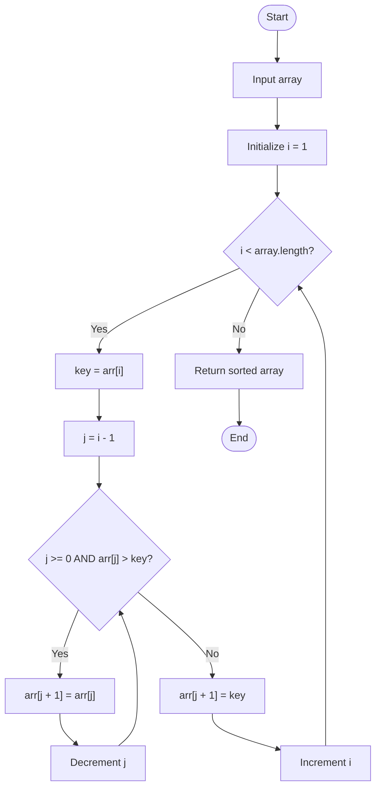

### 6. Complexity Analysis

| Case | Time Complexity |
|---|---|
| Best Case | O(n) |
| Average Case | O(n²) |
| Worst Case | O(n²) |
| Space | O(1) |

**Important Properties:**

- In-place sorting algorithm.
- Stable sorting algorithm.
- Efficient for small or nearly sorted arrays.

---

## Q5(b): Generate Strings Using Backtracking

**Marks:** 10

### 1. Problem Statement

Generate all strings of length 2 from the characters A, B, and C without repeating a character.

### 2. Expected Output

```text
AB, AC, BA, BC, CA, CB
```

### 3. Approach

Use Backtracking.

Three important operations:

1. Choose a character.
2. Explore the next possible character.
3. Undo the choice when returning from recursion.

Use a Set to track characters already selected.

### 4. JavaScript Solution

```javascript
function generateStrings(chars) {
    const result = [];
    const current = [];
    const used = new Set();

    function backtrack() {
        // Base Case
        if (current.length === 2) {
            result.push(current.join(""));
            return;
        }

        for (const char of chars) {
            if (used.has(char)) {
                continue;
            }

            // Choose
            current.push(char);
            used.add(char);

            // Explore
            backtrack();

            // Undo
            current.pop();
            used.delete(char);
        }
    }

    backtrack();

    return result;
}

// Example
console.log(generateStrings(["A", "B", "C"]));

// Output:
// ["AB", "AC", "BA", "BC", "CA", "CB"]
```

### 5. Backtracking Explanation

**Choose:**

```javascript
current.push(char);
used.add(char);
```

Select the character and mark it as used.

**Explore:**

```javascript
backtrack();
```

Recursively explore the next possible character.

**Undo:**

```javascript
current.pop();
used.delete(char);
```

Remove the previous choice to explore another possibility.

### 6. Backtracking Diagram

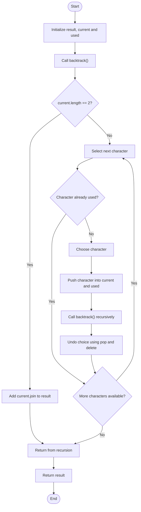

### 7. Complexity Analysis

Let:

- `n` = Number of available characters.
- `k` = Required string length.

Number of permutations:

```text
P(n, k) = n! / (n-k)!
```

| Complexity | Value |
|---|---|
| Time | O(P(n,k) × k) |
| Auxiliary Space | O(k) |
| Output Space | O(P(n,k) × k) |

For three characters and length two:

```text
P(3,2) = 3! / 1! = 6
```

There are six valid strings.

---

# Q6: Callbacks, Closures and Higher-Order Functions

**Marks:** 15 | **Time:** 15 Minutes

**Topics:** Closures, Callbacks, Higher-Order Functions, Array Methods

## Q6(a): Create Discount Using Closure

**Marks:** 7

### 1. Problem Statement

Implement a function `createDiscount(rate)` that returns another function to calculate the final price after applying a percentage discount.

### 2. Example

```javascript
const tenOff = createDiscount(10);

console.log(tenOff(500));
// Output: 450
```

### 3. Approach

Use a JavaScript Closure.

- The outer function accepts the discount rate.
- The inner function accepts the original price.
- The inner function remembers the discount rate.
- Calculate and return the discounted price.

### 4. JavaScript Solution

```javascript
function createDiscount(rate) {
    return function(price) {
        const discount = (price * rate) / 100;

        return price - discount;
    };
}

// Example
const tenOff = createDiscount(10);

console.log(tenOff(500));
// Output: 450

const twentyOff = createDiscount(20);

console.log(twentyOff(1000));
// Output: 800
```

### 5. Closure Explanation

A closure occurs when an inner function remembers variables from its outer function's lexical scope, even after the outer function has completed execution.

In this example:

| Component | Description |
|---|---|
| Outer Function | createDiscount(rate) |
| Inner Function | function(price) |
| Captured Variable | rate |
| Returned Function | Discount calculator |

### 6. Flowchart

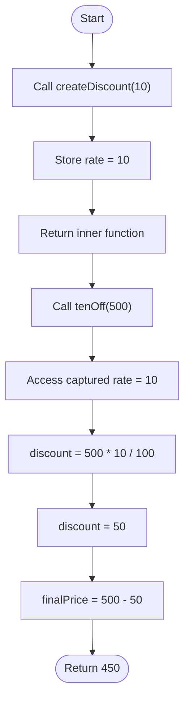

### 7. Complexity Analysis

| Complexity | Value |
|---|---|
| Time | O(1) |
| Space | O(1) |

---

## Q6(b): Filter and Map Students

**Marks:** 8

### 1. Problem Statement

Given an array of students, use `filter()` and `map()` to return the names of students whose scores are greater than or equal to 60.

Convert all returned names into uppercase.

### 2. Input

```javascript
const students = [
    { name: "Ria", score: 72 },
    { name: "Sam", score: 35 },
    { name: "Tia", score: 90 }
];
```

### 3. Approach

**Step 1: filter()**

Select students whose scores are greater than or equal to 60.

**Step 2: map()**

Extract student names and convert them to uppercase.

### 4. JavaScript Solution

```javascript
const students = [
    { name: "Ria", score: 72 },
    { name: "Sam", score: 35 },
    { name: "Tia", score: 90 }
];

const result = students
    .filter(student => student.score >= 60)
    .map(student => student.name.toUpperCase());

console.log(result);

// Output:
// ["RIA", "TIA"]
```

### 5. Execution Breakdown

**Filter Operation:**

```javascript
students.filter(student => student.score >= 60);
```

Result:

```javascript
[
    { name: "Ria", score: 72 },
    { name: "Tia", score: 90 }
]
```

**Map Operation:**

```javascript
.map(student => student.name.toUpperCase());
```

Result:

```javascript
["RIA", "TIA"]
```

### 6. Flowchart

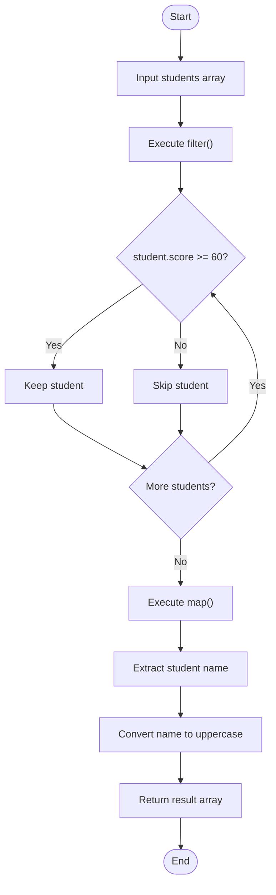

### 7. Complexity Analysis

| Complexity | Value |
|---|---|
| Time | O(n) |
| Space | O(n) |

**Reason:** `filter()` and `map()` each traverse the input array once and create new arrays.

---

# Final Complexity Cheat Sheet

| Question | Concept | Technique | Time Complexity |
|---|---|---|---|
| Q1 | Number Triangle | Nested Loops | O(n²) |
| Q2(a) | Binary Search | Divide and Conquer | O(log n) |
| Q2(b) | Loop Analysis | Doubling | O(log n) |
| Q3(a) | Repeated Word | Set | O(n) |
| Q3(b) | Character Frequency | Map | O(n) |
| Q4(a) | Sum of Digits | Recursion | O(log n) |
| Q4(b) | Climbing Stairs | Memoization | O(n) |
| Q5(a) | Insertion Sort | Sorting | O(n²) |
| Q5(b) | String Generation | Backtracking | O(P(n,k) × k) |
| Q6(a) | Discount Calculator | Closure | O(1) |
| Q6(b) | Student Filtering | filter + map | O(n) |

---

# Important JavaScript Concepts – Quick Revision

| Concept | Key Understanding |
|---|---|
| For Loop | Repeated execution |
| Nested Loops | Loop inside another loop |
| Binary Search | Divide search space into halves |
| Set | Stores unique values |
| Map | Stores key-value pairs |
| Recursion | Function calls itself |
| Base Case | Stops recursion |
| Memoization | Stores previously calculated results |
| Insertion Sort | Inserts elements into sorted positions |
| Backtracking | Choose → Explore → Undo |
| Closure | Inner function remembers outer variables |
| Callback | Function passed to another function |
| Higher-Order Function | Takes or returns another function |
| filter() | Selects matching elements |
| map() | Transforms elements |

---

## Final Notes

- All JavaScript solutions are written without relying on external libraries.
- Binary Search requires a sorted input array.
- Set and Map provide average O(1) lookup, insertion, and deletion.
- Recursion requires a valid base case.
- Memoization avoids repeated calculations.
- Insertion Sort modifies the original array.
- Backtracking explores possible combinations using recursion.
- Closures preserve access to their lexical environment.
- `filter()` and `map()` return new arrays.

**Preparation Focus:** Understand the approach, write the code independently, perform a dry run, and explain time and space complexity for every question.
